# Dexterous Robot Learning — Autonomous Manipulation Platform (Phases 0–17)

A modular, reproducible reinforcement learning, imitation learning, hierarchical control, and sim-to-sim verification platform for autonomous manipulation using a 7-DOF **Franka Emika Panda** arm across **PyBullet** (primary) and **MuJoCo 4.0.1** (cross-simulator parity), executed under **CPU-only PyTorch**.

> **Simulation-Only Verification Notice:** All quantitative results reported in this repository were measured exclusively in **PyBullet** and **MuJoCo 4.0.1** physics simulations. **Phase 17.3 physical robot hardware deployment was explicitly `NOT_ATTEMPTED`**, and **Phase 18** represents unexecuted future scope.

---

## 1. Comprehensive 100-Page Research Monograph (`publication/`)

All architectural design decisions, mathematical derivations (Equations 1–18), debugging forensics (`ERR-001`–`ERR-012`), empirical ablations (`27` experiments, `61` TensorBoard logs, `44` evaluation NPZs), and complete `122`-test regression verification records spanning **Phases 0 through 17** are consolidated into a publication-grade 100-page monograph:

- **Primary PDF Monograph (Exact 100 A4 Pages):** [`publication/Dexterous_Robot_Learning_Phase_1_to_17_Monograph.pdf`](publication/Dexterous_Robot_Learning_Phase_1_to_17_Monograph.pdf)
- **LaTeX & Markdown Sources:** [`publication/Dexterous_Robot_Learning_Monograph.tex`](publication/Dexterous_Robot_Learning_Monograph.tex) · [`publication/research_monograph_source.md`](publication/research_monograph_source.md)
- **PDF QA Report (`0` blanks / `0` clipped boxes):** [`publication/pdf_validation_report.md`](publication/pdf_validation_report.md)
- **Machine-Readable Registries:** [`historical_phase_registry.json`](publication/historical_phase_registry.json) · [`phase_completion_matrix.json`](publication/phase_completion_matrix.json) · [`debugging_history.csv`](publication/debugging_history.csv) · [`experiment_inventory.csv`](publication/experiment_inventory.csv) · [`complete_test_inventory.csv`](publication/complete_test_inventory.csv) · [`project_file_inventory.json`](publication/project_file_inventory.json)

| 4-Layer System Architecture (`Phases 1–17`) | Phase 12 `1M`-Step Learning Breakthrough |
| :---: | :---: |
| 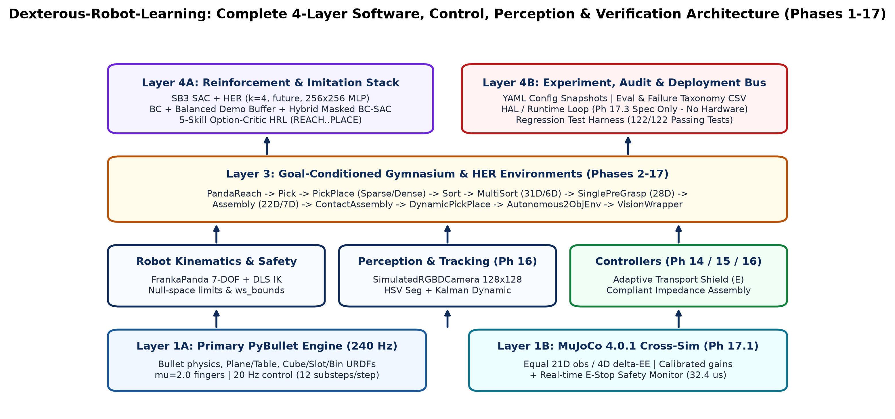 | 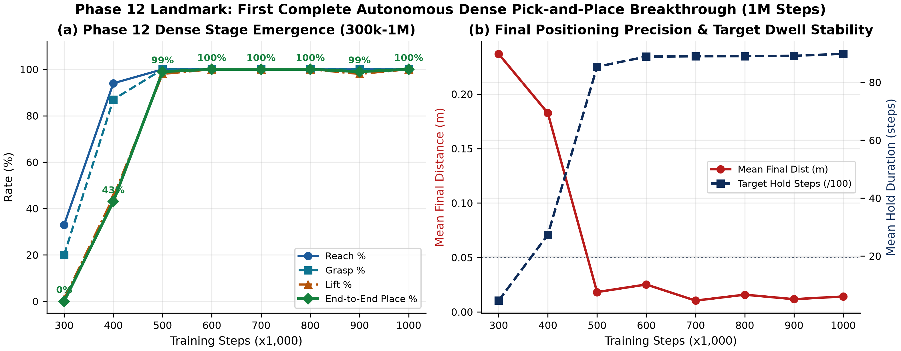 |

---

## 2. Project Milestone Evolution & Current Records (`Phases 0–18`)

| Phase | Milestone / Capability | Verified Empirical Record | Status |
| :--- | :--- | :--- | :---: |
| **0–1** | Kinematics, PyBullet `240 Hz` + DLS IK (`5` waypoints) | `0.7–4.5 mm` error; `0–8 cm` gripper; `37/37` tests | **COMPLETE** |
| **2–10** | GoalEnvs (`Reach -> Assembly`), `HER` friction fix, `DR R0–R4` | Scripted Reach/Pick/PickPlace/Sort/MultiSort/Assembly; `56/56` tests | **COMPLETE** |
| **11** | `25x100k` sparse HER study (`DR0–DR4`) & curriculum | `0%` sparse plateau (static-goal trap); Transport `100%` (`40–50k`) | **COMPLETE** |
| **12** | `1M` Dense `SAC+HER` Pick-and-Place (`Seed 42`) | `43%@400k -> 99%@500k -> 100%@600k–1M` (`0.0142 m`, `89.84` hold) | **COMPLETE** |
| **13–13.5** | DR1/DR2/DR4 training + `1,520`-ep slip forensics | Matched DR4 `99%`, Held-out `57%`; `30.5%` OOD `68.4N->0N` force collapse | **COMPLETE** |
| **14** | Zero-retraining Adaptive Shield (`Ctrl A -> E`) | Held-out DR4 **`57.0% -> 98.0%`** (`+41.0 pp`, Seed 43: `33% -> 99%`); DR0 `100%` | **COMPLETE** |
| **15.1** | Frozen `Ctrl E` perturbation sweep (`320` eps) | Clean/`±3 mm` `97.5%`, `±5 mm` `95.0%`, `1`-lag `72.5%`, `>=2`-lag `0%`, Unpriv `42.5%` | **COMPLETE** |
| **15.2** | `2`-Obj Sorting (`15.2.5A`) + `5B2–5B8` BC-SAC (`5B7`) | Scripted `50/50 (100%)` in `76.4` steps; `5B7` masked BC **`75%` Grasp / `45%` Lift** (`0%` coll); `2`-Obj RL `28D->43D` gated | **PARTIAL** *(RL Gate)* |
| **15.3** | Orientation-aware Peg-in-Slot (`PandaAssemblyDenseEnv`) | Scripted **`56.67%`** insertion (`1.41 deg` align); BC `23.33%` pre-align / `0%`; `111/111` tests | **PARTIAL** *(RL 0%)* |
| **16.1** | `5`-Skill Option-Critic Hierarchical RL (`12k` steps) | **`30.0%`** PickPlace / **`33.33%`** Grasp (`ent 1.79 -> 0.59`) vs **`0.0%`** Flat SAC | **COMPLETE** |
| **16.2** | Oblique `128x128` RGB-D unprojection (`FOV=55 deg`) | **`99.9–100%`** detection, `14.81–15.55 mm` err, `0.9999` IoU; Vision SAC `60%` grasp / `15%` place | **COMPLETE** |
| **16.3** | Kalman velocity tracker (`PandaDynamicPickPlaceEnv`) | **`100%`** linear & moving cube+target, **`95%`** sine & step disturbance (`100%` grasp) | **COMPLETE** |
| **16.4** | Compliant force-impedance peg assembly (`30` eps) | Scripted compliant **`53.33%`** (`pos_err 0.0468 vs 0.0532 m`), `22` jam recoveries | **PARTIAL** |
| **16.6** | Autonomous `2`-Obj RGB-D + HRL + replan (`20` eps) | **`25.0%`** Obj-1 sorting, `0.0%` full `2`-obj, `229` replans, `1,049` safety clamps | **PARTIAL** |
| **17.1** | Cross-Simulator Validation (`PyBullet -> MuJoCo 4.0.1`) | Zero-shot `40%` bilat contact / `5%` grasp; calibrated **`50%` contact / `15%` grasp / `5%` place** | **PARTIAL** *(Gap Quantified)* |
| **17.2** | Sim-to-Real stress (`S1–S6`) & `SafetySupervisor` E-Stop | **`100%`** (`±5mm`/jitter/low-fric+mass), `90%` 1-lag, `60%` `±8mm` RGB-D; **`32.41 us`** E-stop | **COMPLETE** |
| **17.3** | Physical Franka FCI Driver (`StubLiveFrankaDriver` tests) | Unit-tested HAL & safety refusal only; **no physical robot commands executed** | **NOT_ATTEMPTED** |
| **18** | Real-world FCI calibration & visuomotor pretraining | Architectural roadmap only (Chapter 14 of Monograph) | **FUTURE SCOPE** |

> Verified Regression Suite (latest post-edit run): **`122 / 122` passed assertions (`96` AST test functions across `tests/`)**.

---

## 3. Recent Quantitative Results & 3D Visualizations

### A. Phase 15: Multi-Object Sorting, Balanced BC-SAC Grasp Ablations & Peg-in-Slot Assembly

| Single-Object Grasp/Lift Ablation (`5B–5B8`) | Phase 15 Capability Funnel Overview |
| :---: | :---: |
| 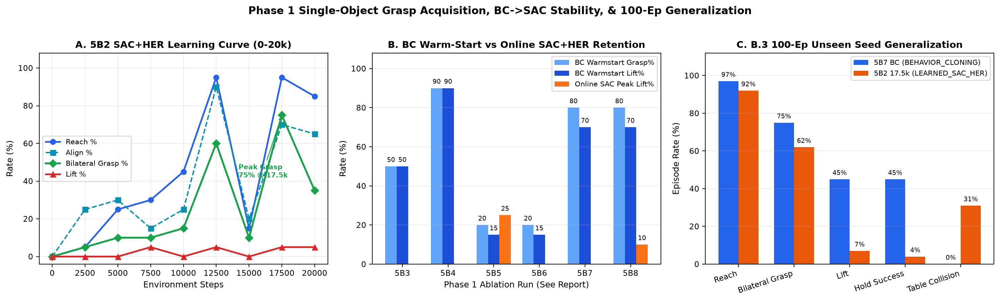 | 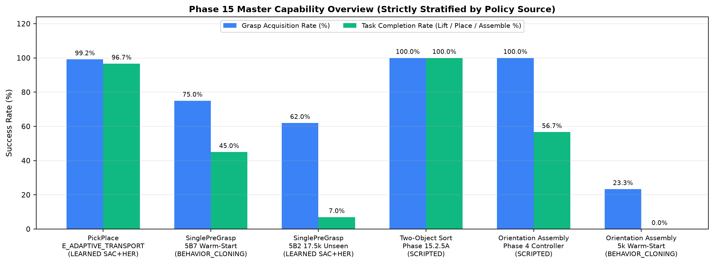 |

| Peg-in-Slot Orientation Assembly (`15.3`) | Frozen DR Robustness Sweep (`Phase 15.1–15.3`) |
| :---: | :---: |
| 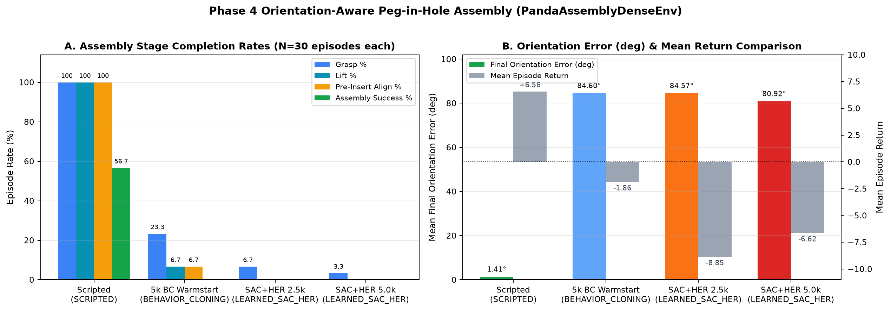 | 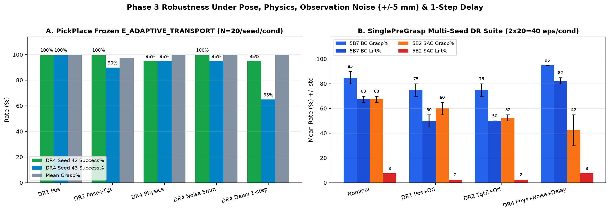 |

---

### B. Phase 16 & 17: Hierarchical RL, Oblique RGB-D, Dynamic Tracking, MuJoCo Parity & Safety

| Phase 16.1–16.2: HRL vs Flat SAC & Oblique RGB-D | Phase 16.3–16.6: Dynamic, Compliant & Autonomous |
| :---: | :---: |
|  |  |

| Phase 17.1–17.2: MuJoCo 4.0.1 Transfer & E-Stop Stress | Phase 0–17 Regression Scaling & CPU Throughput |
| :---: | :---: |
| 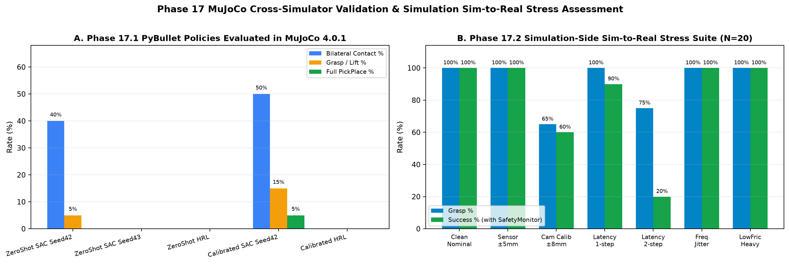 | 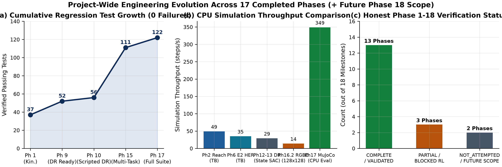 |

---

### C. Live 3D Kinematics, D5 Slip Trajectories & Clip-to-World RGB-D Unprojection

| Live PyBullet `FrankaPanda` 3D Link Chains | Genuine 3D `ep5001` Lift vs `ep5002` Slip Divergence |
| :---: | :---: |
| 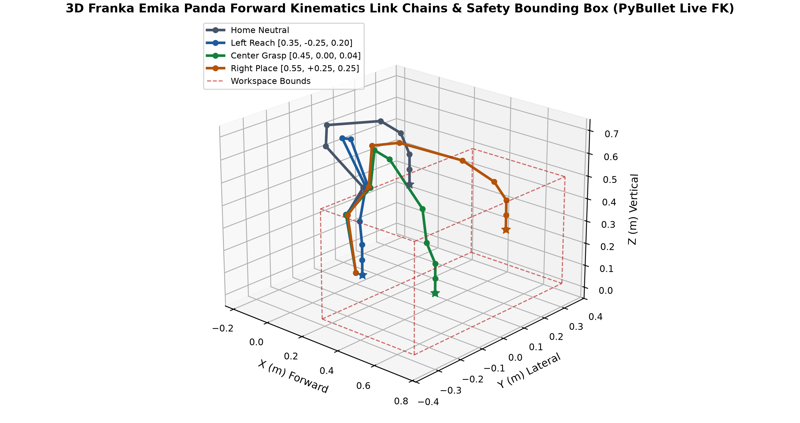 | 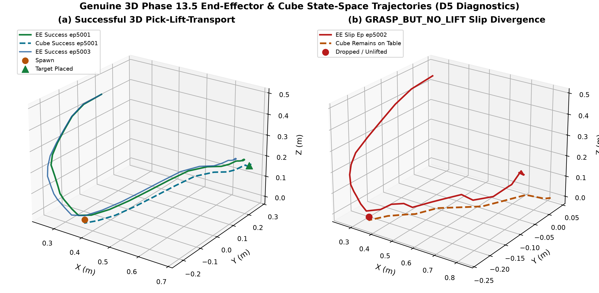 |

| Oblique `55 deg` RGB-D Frustum & Unprojected Cube Cloud (`91 px`) |
| :---: |
| 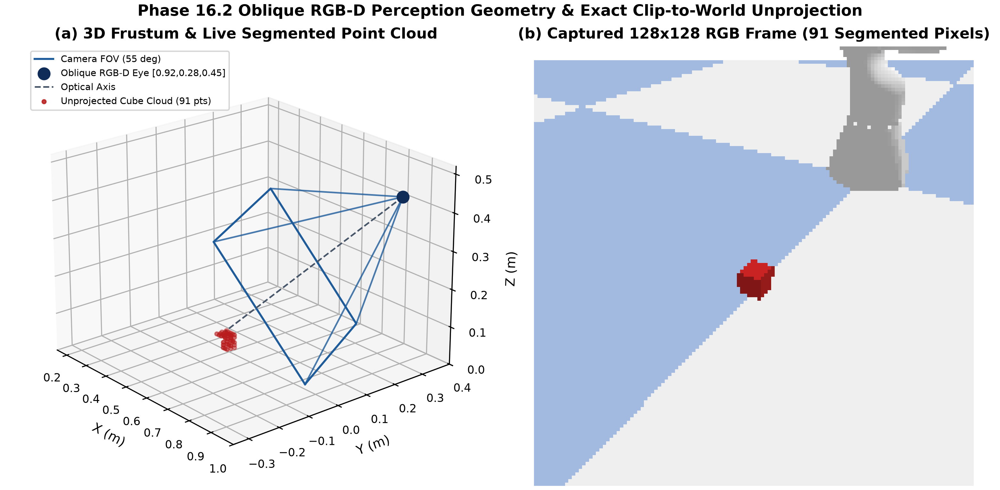 |

---

## 4. Repository Structure

```text
Dexterous-Robot-Learning/
├── README.md
├── LICENSE                                  # Apache License 2.0
├── pyproject.toml & requirements.txt
├── configs/                                 # 30 declarative YAML configs (reach -> assembly_phase15_3)
├── src/
│   ├── controllers/                         # PreGraspController, AssemblyController, CompliantAssemblyController
│   ├── cross_sim/                           # MuJoCoPandaPickPlaceEnv (4.0.1 MJCF parity adapter)
│   ├── deployment/                          # HardwareInterface abstractions, SafetySupervisor, decoupled runtime loop
│   ├── environments/                        # 12 PyBullet Gym/HER Envs (Reach, PickPlace, MultiSort, Dynamic, Assembly)
│   ├── hrl/                                 # Option-Critic SMDP meta-policy & 5-skill neural library
│   ├── objects/                             # Cube, SortingBin, Peg & Slot receptacles
│   ├── perception/                          # SimulatedRGBDCamera (clip-to-world), VisionDetector, Kalman dynamic tracker
│   ├── robots/                              # FrankaPanda 7-DOF DLS IK, workspace clipping & PandaController
│   ├── rl/                                  # train.py, evaluate.py, bc_sac.py, adaptive_controllers.py, transfer_utils.py
│   └── utils/                               # PyBulletSimulation, DomainRandomizer, ConfigDict helpers
├── scripts/                                 # Training, evaluation, balanced demos & Phase 15-17 benchmark runners
├── tests/                                   # 96 test functions expanding to 122/122 passed pytest checks
├── experiments/                             # Saved SB3/HRL models & manifests (*replay_buffer.pkl gitignored)
├── results/                                 # Phase 11 -> Phase 17 JSON/CSV metrics, final reports & charts
├── publication/                             # Complete 100-page PDF Monograph, .tex, .md, 34 PNGs & registries
└── docs/                                    # Architecture, Phase 9-14 technical reports & Phase 17.3 hardware spec
```

---

## 5. Setup, Tests & Monograph Reproduction

### Environment Setup & Test Verification (`122/122`)

```powershell
# Windows Intel OpenMP runtime safety flag + Conda Library bin PATH
$env:KMP_DUPLICATE_LIB_OK = "TRUE"
$env:PATH = "$PWD\.conda-env;$PWD\.conda-env\Library\bin;$PWD\.conda-env\Scripts;$env:PATH"

# Run full repository regression suite (122 passed)
.\.conda-env\python.exe -m pytest -v
```

### Re-Running Benchmarks & Rebuilding the 100-Page Monograph

```powershell
# Reproduce Phase 16 (HRL, RGB-D, Dynamic, Compliant Assembly) & Phase 17 (MuJoCo + Stress)
.\.conda-env\python.exe scripts/run_phase16_1_hrl.py
.\.conda-env\python.exe scripts/run_phase16_2_and_6_vision_auto.py
.\.conda-env\python.exe scripts/run_phase16_3_dynamic.py
.\.conda-env\python.exe scripts/run_phase16_4_contact_assembly.py
.\.conda-env\python.exe scripts/run_phase17_cross_sim_and_safety.py

# Regenerate all registries, 34 publication figures, 100-page PDF & validation report
.\.conda-env\python.exe publication/build_registries.py
.\.conda-env\python.exe publication/generate_all_figures.py
.\.conda-env\python.exe publication/build_monograph_pdf.py
.\.conda-env\python.exe publication/validate_pdf.py
```

### Launching the Web Robotics Workstation (`backend/` + `frontend/`)

Terminal 1 — Authoritative PyBullet FastAPI Backend (`http://127.0.0.1:8000`):
```powershell
.\scripts\startup\start_backend.ps1
```

Terminal 2 — React + Three.js Industrial Workstation Frontend (`http://localhost:5173`):
```powershell
.\scripts\startup\start_frontend.ps1
```

Run combined Python + FastAPI/WebSocket tests & Frontend Vitest/Vite build:
```powershell
$env:KMP_DUPLICATE_LIB_OK = "TRUE"
.\.conda-env\python.exe -m pytest tests backend/tests -q
cd frontend; npm test; npm run build
```

---

## 6. Key Technical Documentation Index

- **Workstation Reports & Audit:** [Website Development Report](docs/website_development_report.md) · [Implementation Status](docs/implementation_status.md) · [Repository Audit](docs/repository_audit.md) · [Backend API & WS Spec](docs/api/backend_api_and_ws.md) · [Robotics Integration](docs/architecture/robotics_integration.md)

- **Master 100-Page Monograph:** [`publication/Dexterous_Robot_Learning_Phase_1_to_17_Monograph.pdf`](publication/Dexterous_Robot_Learning_Phase_1_to_17_Monograph.pdf)
- **Phase 17 Deployment Readiness Report:** [`results/phase16_17/PHASE17_DEPLOYMENT_READINESS_REPORT.md`](results/phase16_17/PHASE17_DEPLOYMENT_READINESS_REPORT.md)
- **Phase 16 Final Technical Report:** [`results/phase16_17/PHASE16_FINAL_TECHNICAL_REPORT.md`](results/phase16_17/PHASE16_FINAL_TECHNICAL_REPORT.md)
- **Phase 15 Final Technical Report:** [`results/phase15_master/PHASE15_FINAL_TECHNICAL_REPORT.md`](results/phase15_master/PHASE15_FINAL_TECHNICAL_REPORT.md)
- **Phase 14.4 Adaptive Transport Confirmation:** [`results/phase14_4/phase14_4_final_report.md`](results/phase14_4/phase14_4_final_report.md)
- **Phase 17.3 Hardware Interface Spec (Not Attempted on Physical Robot):** [`docs/phase17_3_hardware_architecture.md`](docs/phase17_3_hardware_architecture.md)
