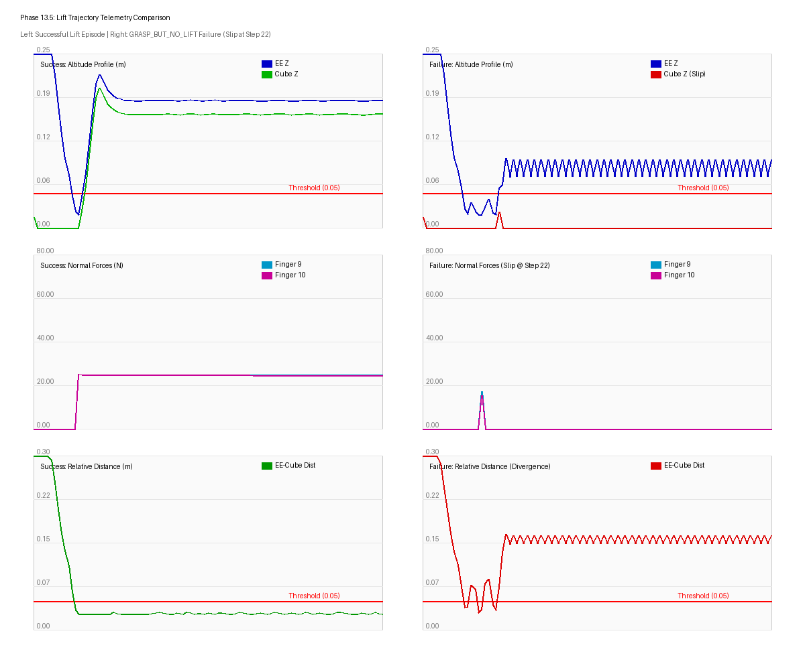
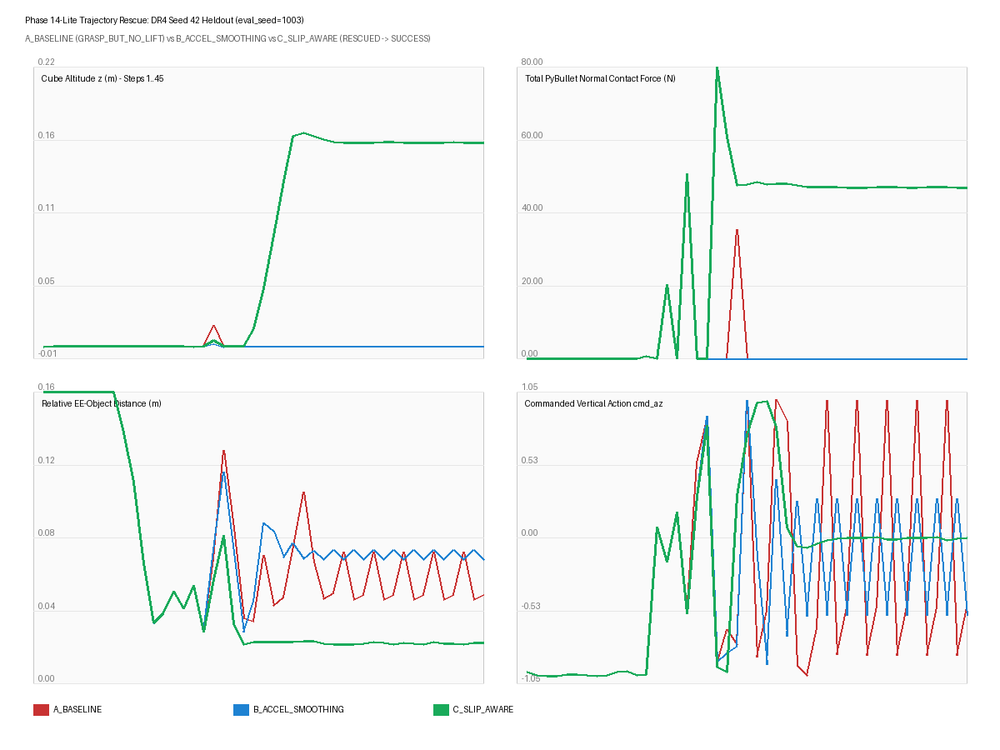
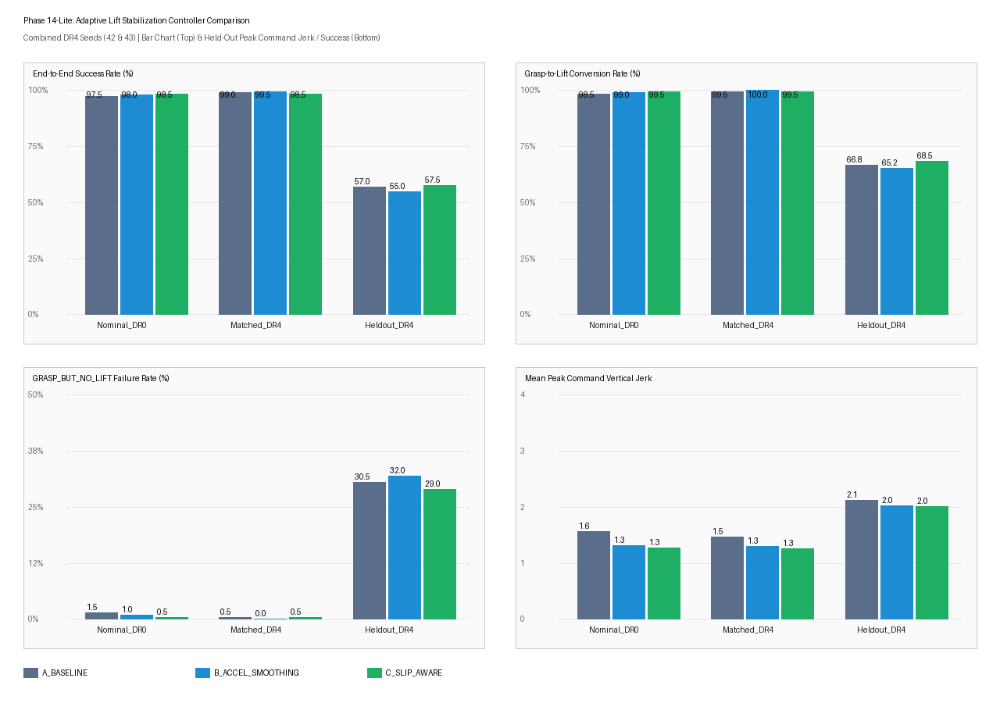
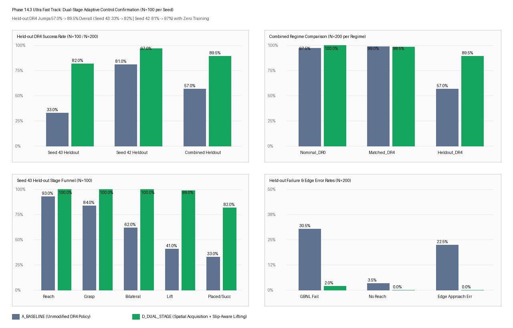
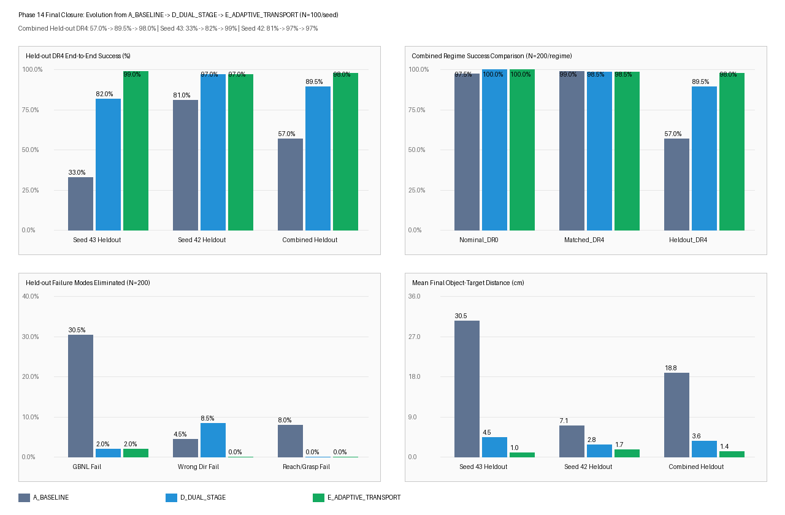
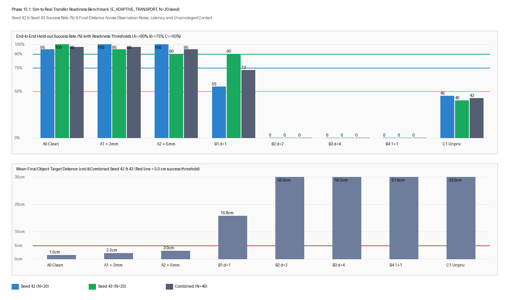
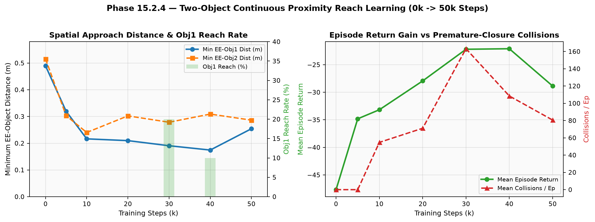
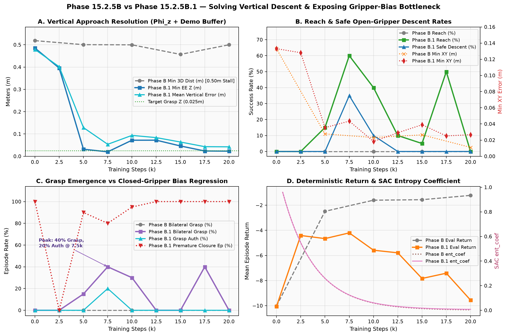
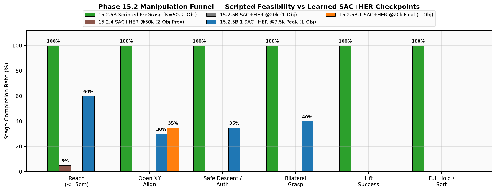

# Dexterous Robot Learning — Goal-Conditioned Manipulation Platform (SAC + HER)

A modular, reproducible reinforcement learning and adaptive control platform for goal-conditioned robotic manipulation using **Soft Actor-Critic (SAC)** paired with **Hindsight Experience Replay (HER)** on a 7-DOF **Franka Emika Panda** arm in **PyBullet**.

---

## 1. Project Overview & Current Milestone

The repository began with sparse-reward goal-conditioned benchmarks (`Reach`, `Pick`, `PickPlace`, `Sort`, `MultiSort`, `Assembly`) and evolved through domain-randomized dense RL (**Phases 11–13.5**), controller-level OOD generalization without SAC retraining (**Phase 14: 98.0% Held-out DR4 / 100.0% Nominal DR0**), sim-to-real perturbation benchmarking (**Phase 15.1**), and hierarchical curriculum/reward engineering for **Two-Object Sequential Sorting (`Phase 15.2`)**.

| Milestone Window | Primary Achievement | Current Verdict |
| :--- | :--- | :---: |
| **Phases 0–13** | Robot kinematics/IK, GoalEnvs (`Reach -> Assembly`), DR4 SAC+HER (`500k` Seed 42/43: `99%` Matched DR4, `57%` Held-out DR4 baseline) | **COMPLETE** |
| **Phase 13.5** | Failure taxonomy revealing OOD `GRASP_BUT_NO_LIFT` (`30.5%`) and workspace-edge misses | **COMPLETE** |
| **Phase 14 (14-Lite / 14.3 / 14.4)** | Zero-retraining adaptive control (`C_SLIP_AWARE -> D_DUAL_STAGE -> E_ADAPTIVE_TRANSPORT`): **`98.0%`** Held-out DR4 (`99.0%` Seed 43, `97.0%` Seed 42), **`100.0%`** DR0, **`98.5%`** Matched DR4 (`N=200–600`) | **COMPLETE** |
| **Phase 15.1** | Frozen `E_ADAPTIVE_TRANSPORT` robustness (`320` eps): **Class A (`±3–5 mm` obs noise: `95–97.5%`)**, **Class C/D (`>=1–2 step` latency: `72.5% -> 0%`)**, **Class D (unprivileged force stripping: `42.5%`)** | **COMPLETE** |
| **Phase 15.2.1–15.2.4** | MultiSort dense reward + continuous proximity (`PandaMultiSortDenseV2Env`): `0->50k` reduced min EE-Obj1 distance **`0.4893 m -> 0.1745 m`** (`20%` O1 Reach, `0%` Grasp) | **COMPLETE** |
| **Phase 15.2.5A** | Collision-aware [`PreGraspController`](src/controllers/pregrasp_controller.py) state machine + HER-compatible reward (`24/24` tests, **`50/50 (100%)`** scripted two-object sequential sorting, `0` table collisions) | **COMPLETE** |
| **Phase 15.2.5B** | Single-object curriculum (`PandaSinglePreGraspEnv`, `22D/3D`) & verified `28D -> 43D` transfer adapter (`373,260 -> 392,460` params, `9/9` tests); `20k` SAC+HER converged to XY hover at `z = 0.50 m` (`0%` Grasp) | **BLOCKED (Gate Halt)** |
| **Phase 15.2.5B.1** | Verified downward action pathway (`0.485 m -> 0.0216 m`), added un-gated $\Phi_z$ (`w_z = 2.0`), generated `50/50` demos, seeded `HerReplayBuffer`; `z_err` dropped **`0.4790 m -> 0.0424 m`**, peak **`60%` Reach & `40%` Bilateral Grasp** at `7.5k`, but closed-gripper demo bias (`78.4%`) held `Lift = 0%` at `20k` (`16/16` tests passing) | **PARTIALLY COMPLETE** |
| **Phase 15.2.5B.2 → 15.2.8** | Demo rebalancing (`65–75%` open descent), decaying BC warm-start & entropy floor, `100`-ep generalization, `28D->43D` transfer to two-object sorting | *Next / Planned* |
| **Phase 15.3.1 → 15.3.5** | Orientation-aware quaternion manipulation, peg-in-hole / slot alignment, contact-rich insertion & multi-part assembly | *Planned* |

---

## 2. Empirical Results & Visualizations

### A. Phase 13.5 → Phase 14.4: Resolving OOD Manipulation Without SAC Retraining

Across `DR4 Seed 42` and `DR4 Seed 43` frozen checkpoints (`SHA-256` verified), controller-level interventions resolved pre-lift slipping (**14-Lite**), workspace-edge grasp acquisition (**14.3**), and post-lift overshoot/direction bias (**14.4**), raising combined Held-out DR4 end-to-end success from **`57.0% -> 98.0%`** (`N = 200`, Seed 43: `33.0% -> 99.0%`).

| Phase 13.5 Diagnostic: Lift Failure Mechanism | Phase 14-Lite: Slip-Aware Lift Stabilization |
| :---: | :---: |
|  |  |

| Phase 14-Lite Controller Ablation (`A`, `B`, `C`) | Phase 14.3 Spatial Grasp Acquisition (`D_DUAL_STAGE`) |
| :---: | :---: |
|  |  |

| Phase 14.4 Final Adaptive Transport (`E_ADAPTIVE_TRANSPORT`) |
| :---: |
|  |

---

### B. Phase 15.1: Sim-to-Real Transfer Readiness (`E_ADAPTIVE_TRANSPORT`)

Evaluating the frozen Phase 14 controller across `320` paired episodes established strong pose-noise resilience (**`97.5%`** at `±3 mm`, **`95.0%`** at `±5 mm`), severe closed-loop sensitivity above `1` control step (**`72.5%` at 1-step -> `0.0%` at 2+ steps**), and reliance on privileged PyBullet bilateral contact forces (**`42.5%`** with kinematic jaw-stall fallback).



---

### C. Phase 15.2: Multi-Object Sorting Learning Progression (`15.2.4` → `15.2.5B.1`)

1. **Continuous Proximity Reach (`Phase 15.2.4`, `0 -> 50k`)**: Reduced minimum EE-to-Object-1 distance from **`0.4893 m` to `0.1745 m`** (`20%` Reach), but premature gripper closure caused up to `163.2` collisions/ep with `0%` grasping.



2. **Pre-Grasp Controller Feasibility vs Learned RL Funnel (`Phase 15.2.5A–B.1`)**: While the scripted [`PreGraspController`](src/controllers/pregrasp_controller.py) achieved **`50/50 (100.0%)`** two-object sorting (`76.4` mean steps, `0` collisions), SAC+HER in **Phase B** parked at `z = 0.50 m` due to XY-gated vertical rewards. Introducing continuous vertical potential $\Phi_z = -2.0 \cdot \operatorname{clip}(|z_{EE} - z_{\text{grasp}}|, 0, 1)$ plus a `4,000`-transition `HerReplayBuffer` demo warm-start in **Phase B.1** solved vertical descent (`z_err: 0.4790 m -> 0.0424 m`, `minZ = 0.0200 m`) and achieved **`60.0%` Reach** and **`40.0%` Bilateral Grasp** at `7,500` steps—before closed-gripper bias from the demo holding tail (`78.4%` closed actions) pushed premature closure to `100%` by `20k`.





---

## 3. Repository Structure

```text
Dexterous-Robot-Learning/
├── README.md
├── LICENSE                                  # Apache License 2.0
├── pyproject.toml & requirements.txt
├── configs/                                 # Declarative YAML training & evaluation configs
│   ├── pick_place_dr*.yaml / phase14_4_config.yaml / phase15_1_config.yaml
│   └── multi_sort_phase15*.yaml             # 15.2.2, 15.2.4, 15.2.5A, 15.2.5B, 15.2.5B1
├── src/
│   ├── controllers/                         # Phase 15.2.5A PreGraspController state machine
│   ├── environments/                        # Reach, Pick, PickPlace, Sort, MultiSort, Dense/PreGrasp variants, Assembly
│   ├── objects/                             # Cube, SortingBin, mechanical assembly parts/targets
│   ├── robots/                              # FrankaPanda URDF/IK/workspace & PandaController
│   ├── rl/                                  # train.py, evaluate.py, adaptive_controllers.py, transfer_utils.py, Phase 15.1 wrappers
│   └── utils/                               # PyBulletSimulation, DomainRandomizer, config loaders
├── scripts/                                 # Demo generation, checkpoint evaluation, chart generation
├── tests/                                   # Unit, kinematic, HER compatibility, vertical pathway, transfer tests
├── experiments/                             # Saved model checkpoints (.zip), demos, manifests (*replay_buffer.pkl gitignored)
├── results/                                 # Structured JSON metrics, Markdown audit/final reports, and PNG figures
└── docs/                                    # Architecture, methodology, experiment & Phase 10 reports
```

---

## 4. Setup & Verification

### Environment Installation

```powershell
# 1. Create Python 3.11 Conda/Micromamba environment with PyBullet
micromamba create -p .\.conda-env -c conda-forge python=3.11 pybullet -y

# 2. Install RL and scientific dependencies
uv pip install --python .\.conda-env\python.exe -r requirements.txt
```

### Running Tests & Benchmarks

```powershell
# Run Phase 15.2.5A + 15.2.5B + 15.2.5B.1 verification suite (16/16 passing)
.\.conda-env\python.exe -m pytest tests/test_vertical_action_pathway.py tests/test_vertical_potential_reward_her.py tests/test_b1_demos_and_warmstart.py tests/test_single_pregrasp_and_transfer.py tests/test_pregrasp_controller.py tests/test_pregrasp_reward.py tests/test_pregrasp_her_compatibility.py -v

# Re-run full repository test suite
.\.conda-env\python.exe -m pytest -v

# Reproduce Phase 14.4 Adaptive Transport confirmation / Phase 15.1 Sim-to-Real benchmark
.\.conda-env\python.exe run_phase14_4.py
.\.conda-env\python.exe run_phase15_1.py

# Regenerate Phase 15.2 figures from results/*.json
$env:PATH = "$PWD\.conda-env;$PWD\.conda-env\Library\bin;$PWD\.conda-env\Scripts;$env:PATH"
.\.conda-env\python.exe scripts/generate_phase15_2_charts.py
```

---

## 5. Detailed Documentation Links

- **Phase 14 Closure**: [Phase 14.4 Final Report](results/phase14_4/phase14_4_final_report.md)
- **Phase 15.1 Readiness**: [Phase 15.1 Final Report](results/phase15_1/phase15_1_final_report.md)
- **Phase 15.2.4 Proximity**: [Phase 15.2.4 Final Report](results/phase15_2_4/phase15_2_4_final_report.md)
- **Phase 15.2.5A Pre-Grasp**: [Phase 15.2.5A Final Report](results/phase15_2_5A/phase15_2_5A_final_report.md)
- **Phase 15.2.5B / B.1**: [Phase 15.2.5B Final Report](results/phase15_2_5B/phase15_2_5B_final_report.md) · [Phase 15.2.5B.1 Final Report](results/phase15_2_5B1/phase15_2_5B1_final_report.md) · [Phase 15.2.5C Transfer Audit](results/phase15_2_5C/phase15_2_5C_transfer_audit.md)
