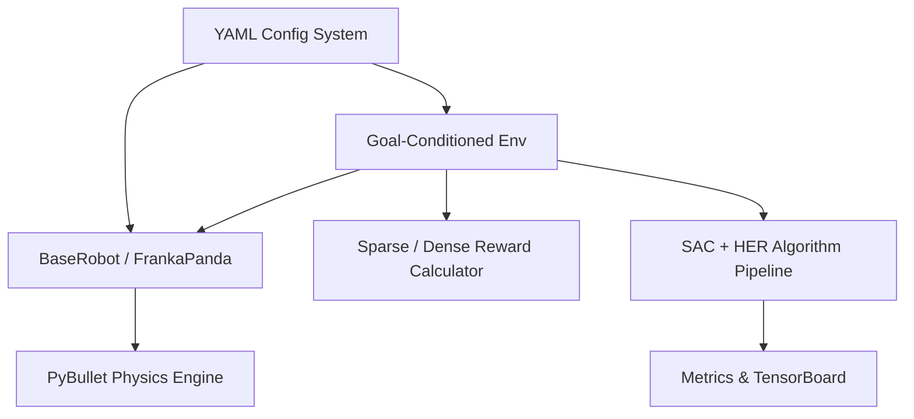

# System Architecture

## Design Principles
1. **Decoupled Layers**: Simulation, robot actuation, environment task logic, RL algorithms, and evaluation protocols are isolated behind clean abstract interfaces.
2. **Backend Independence**: Robot models inherit from `BaseRobot`. Kinematic and simulator logic can target PyBullet or MuJoCo without touching RL or task environments.
3. **Cartesian End-Effector Control**: Action spaces control end-effector displacement `[dx, dy, dz, gripper]` mapped to joint positions via Inverse Kinematics (IK), preventing premature joint explosion in early curriculum phases.
4. **Goal-Conditioned Paradigm**: All environments strictly implement the standard Gymnasium GoalEnv dictionary observation interface:
   - `observation`: State vector of robot (EE position, EE velocity, gripper width).
   - `achieved_goal`: Current position/state of the manipulated entity.
   - `desired_goal`: Target position/state required for task completion.
5. **Config-Driven Parameterization**: No hard-coded simulation constants, velocities, or hyper-parameters; all parameters reside in `configs/*.yaml`.

---

## Component Layout

### Module Responsibilities
- `src/robots/base_robot.py`: Abstract contract for manipulators. Defines EE state extraction, joint commands, and Cartesian actuation.
- `src/robots/panda.py`: Concrete Franka Panda implementation. Manages URDF loading, damped least-squares IK with null-space rest pose projection, workspace bounding box safety clipping, and parallel-jaw finger actuation.
- `src/utils/config.py`: Attribute-accessible `ConfigDict` with recursive inheritance and merging capabilities.
- `src/environments/`: Gymnasium goal-conditioned environments (Phase 2+).
- `src/rl/`: Stable-Baselines3 SAC and HerReplayBuffer wrappers with deterministic seeding and evaluation callbacks (Phase 3+).
