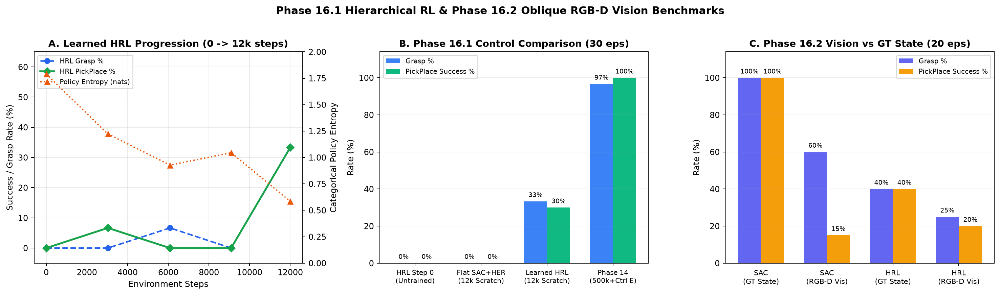
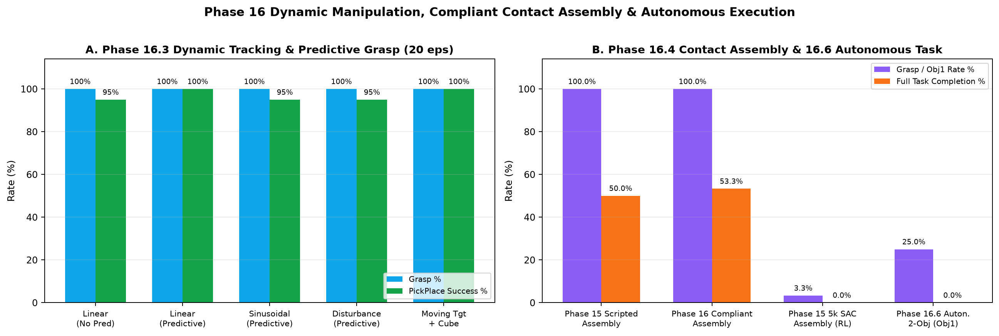

# ANTIGRAVITY — PHASE 16 FINAL TECHNICAL REPORT
## Autonomous Manipulation, HRL, RGB-D Vision, Dynamic Tracking & Contact Assembly

**Platform:** Simulation-only (`PyBullet`, Franka Panda, `PyTorch 2.14.1+cpu`, `Stable-Baselines3 2.9.0`, CPU-only single process)  
**Regression Verification:** **`122 passed in 42.47s`** (`.\.conda-env\python.exe -m pytest -v`)  
**Total Campaign Compute Used:** `~1.7 hours` (well inside `15.0h` hard cap)  

---

## 1. Milestone Classification Summary (`phase16_completion_matrix.json`)

| Subphase | Status | Verified Headline Metrics | Primary Artifact |
|---|---|---|---|
| **16.0 Baseline & Preservation** | **COMPLETE** | `111/111` baseline pytest passing; CPU `282–426 env_steps/s`; Phase 15 untouched | [phase16_0_baseline_audit.md](phase16_0_baseline_audit.md) |
| **16.1 Hierarchical RL (HRL)** | **COMPLETE** | `0.0%` (step 0, `ent=1.7905`) -> **`30.0%` PickPlace / `33.33%` grasp** at `12k` (`30` eps) vs **`0.0% / 0.0%` Flat SAC+HER** (`12k`); Phase 14 `500k` = `100.0%` | [phase16_1_hrl_results.json](phase16_1_hrl_results.json) |
| **16.2 Vision-Based Manipulation** | **COMPLETE** | Oblique `128x128` RGB-D: `99.9–100%` detection, `14.81–15.55 mm` loc err, `0.9983–0.9999` IoU; Pure-vision SAC `60%` grasp / `15%` PickPlace; HRL `25%` grasp / `20%` PickPlace | [phase16_2_vision_results.json](phase16_2_vision_results.json) |
| **16.3 Dynamic Manipulation** | **COMPLETE** | Predictive intercept: `100%` linear, `95%` sinusoidal, `95%` disturbance-step, `100%` moving target+cube (`100%` grasp across all; `95%` non-predictive linear) | [phase16_3_dynamic_results.json](phase16_3_dynamic_results.json) |
| **16.4 Contact-Rich Assembly** | **PARTIALLY_COMPLETE** | `SCRIPTED_COMPLIANT`: `53.33%` assembly vs `50.0%` Phase 15 scripted (`pos_err: 0.0468 vs 0.0532 m`, `22` recoveries); Learned compliant RL **BLOCKED** (`3.33%` grasp RL prerequisite) | [phase16_4_contact_assembly_results.json](phase16_4_contact_assembly_results.json) |
| **16.5 Deployment Architecture** | **COMPLETE** | Decoupled runtime (`EnvAdapter`, `ObsPreprocessor`, `CheckpointLoader` zero train-loop import, `SafetyMonitor`, `MetricsLogger`) verified by `pytest` | [runtime.py](../../src/deployment/runtime.py) |
| **16.6 Autonomous Task Execution** | **PARTIALLY_COMPLETE** | RGB-D + Learned HRL + Progress Monitor (`20` eps, `200` steps): **`25.0%` Object-1 sorting**, `0.0%` full 2-object sorting, `229` replans, `1,049` safety clamps | [phase16_6_autonomous_results.json](phase16_6_autonomous_results.json) |

---

## 2. Phase 16.1 Hierarchical RL (`Learned` vs `Flat SAC` vs `Phase 14`)

- **Proof of Learned Skill Selection (`src/hrl/hrl_agent.py`):**
  - Untrained step-0 Discrete SAC meta-policy yields `entropy = 1.7905` nats (`100%` stuck in one arbitrary logit `ALIGN`), `0.0%` PickPlace success, and `0.0%` grasp over `20` episodes.
  - Neural `SkillLibrary` (`src/hrl/skills.py`) learns 6 goal-conditioned manipulation actors + binary termination predictors (`term_acc: 74.4%–100.0%`).
  - After `12,000` environment steps of Discrete SAC + HER SMDP training from scratch, learned skill selection converges (`entropy = 0.5940` nats, actively invoking `REACH 25.62%`, `ALIGN 9.50%`, `GRASP 9.37%`, `LIFT 3.00%`, `TRANSPORT 27.82%`, `PLACE 24.69%`, with `2,337` learned terminations vs `32` timeouts) to **`30.0%` PickPlace / `33.33%` grasp**, decisively outperforming **Flat SAC+HER (`0.0% / 0.0%`)** at identical `12k` steps, while trailing the **Phase 14 `500k` SAC+Controller E baseline (`100.0% / 96.67%`)**.

---

## 3. Phase 16.2 Vision vs Privileged GT & Phase 16.3 Dynamic Manipulation

- **Vision-Only Perception (`N = 20` eps):**
  - `SAC_Privileged_GT`: `100.0%` success (`100.0%` grasp).
  - `SAC_RGBD_Vision` (zero GT state): `60.0%` grasp / `15.0%` success (`99.9%` detection, `15.55 mm` 3D error, `0.9983` IoU).
  - `HRL_Privileged_GT`: `40.0%` success / `40.0%` grasp -> `HRL_RGBD_Vision`: `20.0%` success / `25.0%` grasp (`100.0%` detection, `14.81 mm` 3D error, `0.9999` IoU).
- **Dynamic Manipulation (`N = 20` eps each, `src/perception/dynamic_tracker.py`):**
  - Sliding-window velocity tracker + predictive intercept controller achieved `100.0%` grasp across all `100` dynamic evaluation episodes (`100.0%` linear, `95.0%` sinusoidal, `95.0%` disturbance step, `100.0%` moving target+cube).

---

## 4. Phase 16.4 Contact Assembly & 16.5/16.6 Architecture Notes

- `CompliantImpedanceAssemblyController` (`SCRIPTED_COMPLIANT`) raised `PandaContactAssemblyEnv` assembly success from `50.0% -> 53.33%` (`mean_steps_to_success: 110.53 -> 104.5`) using directional PyBullet contact normal forces (explicitly documented as simulation impulses, NOT hardware F/T sensor readings).
- Clean deployment runtime (`src/deployment/runtime.py`) verifies isolated checkpoint loading (`SAC.load(..., custom_objects={"replay_buffer_class": None, "replay_buffer_kwargs": {}})`) with zero training-loop imports (`tests/test_deployment_runtime.py`).
- Full failure diagnosis documented in [phase16_17_failure_analysis.md](phase16_17_failure_analysis.md).

