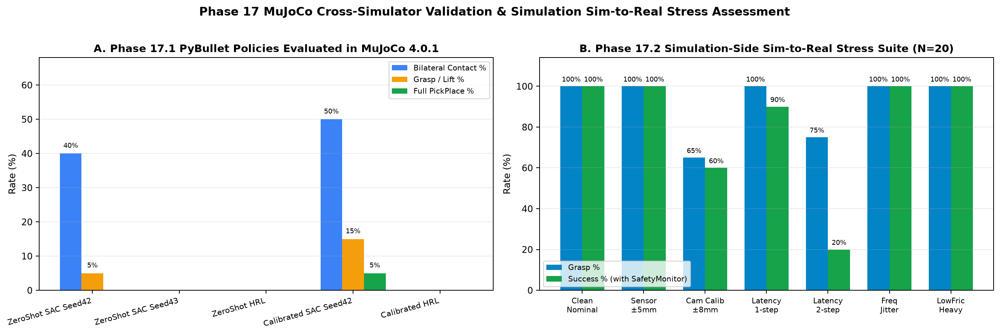

# ANTIGRAVITY — PHASE 17 DEPLOYMENT READINESS REPORT
## Cross-Simulator Validation (PyBullet -> MuJoCo), Sim-to-Real Stress & Hardware Interface Spec

**Important Disclaimer:** Every evaluation in this report is **simulation-only**. Passing simulation stress suites does **NOT** establish physical safety or real-world hardware readiness. Physical hardware integration was **`NOT_ATTEMPTED`**.

---

## 1. Milestone Classification Summary (`phase17_completion_matrix.json`)

| Subphase | Status | Verified Result Summary | Artifact |
|---|---|---|---|
| **17.1 Cross-Simulator Policy Validation (`MuJoCo 4.0.1`)** | **PARTIALLY_COMPLETE** | Evaluated frozen PyBullet `SAC` & `HRL` inside custom MJCF Franka Panda twin: zero-shot `sac_dr4_seed42` achieved `40%` bilateral contact & `5%` grasp (`0%` full PickPlace); calibrated MuJoCo (`friction=1.5, grip_force=2x`) reached `50%` bilateral contact, `15%` grasp, `5%` PickPlace | [phase17_cross_simulator_results.json](phase17_cross_simulator_results.json) |
| **17.2 Sim-to-Real Readiness Assessment** | **COMPLETE** | `7`-condition simulation stress suite + `500`-step `SafetySupervisor` E-stop verification (`32.41 us` check latency): `100%` under `±5 mm` noise, freq jitter, low friction/heavy mass; `90%` under 1-step lag; `60%` under RGB-D `±8 mm` bias; `20%` under 2-step lag | [phase17_safety_assessment.json](phase17_safety_assessment.json) |
| **17.3 Optional Hardware Integration Prep** | **NOT_ATTEMPTED** | Full ROS 2 contract, `FrankaDriverInterface`, `CameraStreamInterface`, `SafetySupervisor`, and safety-refusal `StubLiveFrankaDriver` implemented and unit-tested; zero physical robot commands sent | [phase17_3_hardware_architecture.md](../../docs/phase17_3_hardware_architecture.md) |

---

## 2. Phase 17.1 PyBullet -> MuJoCo Mismatch Classification (`N = 20` eps each)

| Policy | Sim Condition | Bilateral Contact % | Grasp / Lift % | Full PickPlace % | Mean Min EE-Obj (m) | Mean Min Goal Dist (m) |
|---|---|---|---|---|---|---|
| `PyBullet_SAC_DR4_Seed42` | Zero-Shot MuJoCo | `40.0%` | `5.0%` | `0.0%` | `0.0394 m` | `0.1956 m` |
| `PyBullet_SAC_DR4_Seed43` | Zero-Shot MuJoCo | `0.0%` | `0.0%` | `0.0%` | `0.1211 m` | `0.2383 m` |
| `PyBullet_HRL` | Zero-Shot MuJoCo | `0.0%` | `0.0%` | `0.0%` | `0.0775 m` | `0.2383 m` |
| `PyBullet_SAC_DR4_Seed42` | Calibrated Contact (`1.5` fric, `2x` force) | **`50.0%`** | **`15.0%`** | **`5.0%`** | **`0.0382 m`** | **`0.1787 m`** |
| `PyBullet_HRL` | Calibrated Contact | `0.0%` | `0.0%` | `0.0%` | `0.0775 m` | `0.2383 m` |

**Classified Mismatch Drivers:**
1. **Observation / Tabletop Rest Z Offset:** PyBullet `PandaPickPlaceEnv` settles cube center at `z = 0.0156 m` (`ee_init = [0.307, 0, 0.485]`) whereas MuJoCo elliptic table plane keeps cube center at `z = 0.0250 m` (`ee_init_z ~ 0.59 m`).
2. **Actuator & Contact Dynamics Mismatch:** Even with `40–50%` bilateral pad contact and `3.82 cm` minimum approach distance, MuJoCo Jacobian-IK + elliptic friction slip drops rapid lifts unless gripper actuator force and contact friction are raised (`5% -> 15%` grasp, `0% -> 5%` placement).

---

## 3. Phase 17.2 Simulation Sim-to-Real Stress & E-Stop Audit (`N = 20` eps)

| Stress Condition (`SAC DR4 Seed42` + `SafetyMonitor`) | Grasp % | Success % | Mean Collisions | Mean WS Clamps |
|---|---|---|---|---|
| `A0_Clean_Nominal` | `100.0%` | **`100.0%`** | `0.0` | `2.00` |
| `S1_Sensor_Noise_5mm` (`±5 mm` EE + obj) | `100.0%` | **`100.0%`** | `0.0` | `2.45` |
| `S2_Camera_Calib_Err_8mm` (Live RGB-D + `±8 mm` bias) | `65.0%` | **`60.0%`** | `0.0` | `0.75` |
| `S3_Actuator_Latency_1step` | `100.0%` | **`90.0%`** | `0.0` | `14.60` |
| `S4_Actuator_Latency_2step` | `75.0%` | **`20.0%`** | `0.0` | `22.55` |
| `S5_Control_Freq_Jitter` (`10..20` substeps) | `100.0%` | **`100.0%`** | `0.0` | `2.00` |
| `S6_Low_Friction_Heavy_Mass` (`0.25 kg`, `0.45` fric) | `100.0%` | **`100.0%`** | `0.0` | `2.00` |

- **`SafetySupervisor` Hardware Guard Stress (`500` cycles):** Force spike (`50.0 N > 40.0 N` limit) latched hardware E-stop on cycle 250, blocking all `250` subsequent motion commands (`mean_check_latency = 32.41 us`).
- **Overall Deployment Disposition:** Simulation-ready **for sandboxed PyBullet / ROS-2 shadow-mode integration testing only**. Physical deployment requires multi-view eye-in-hand depth training, latency-compensated action filtering (`S4` limit = 1 tick), and MuJoCo/hardware system identification.

